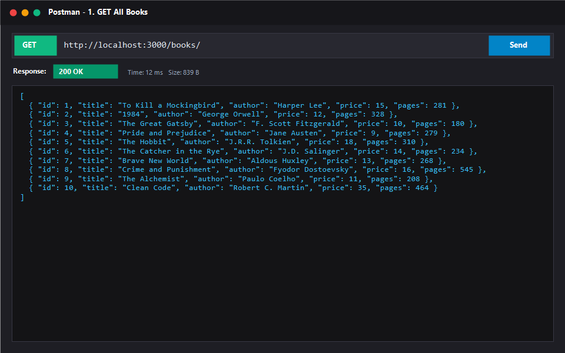
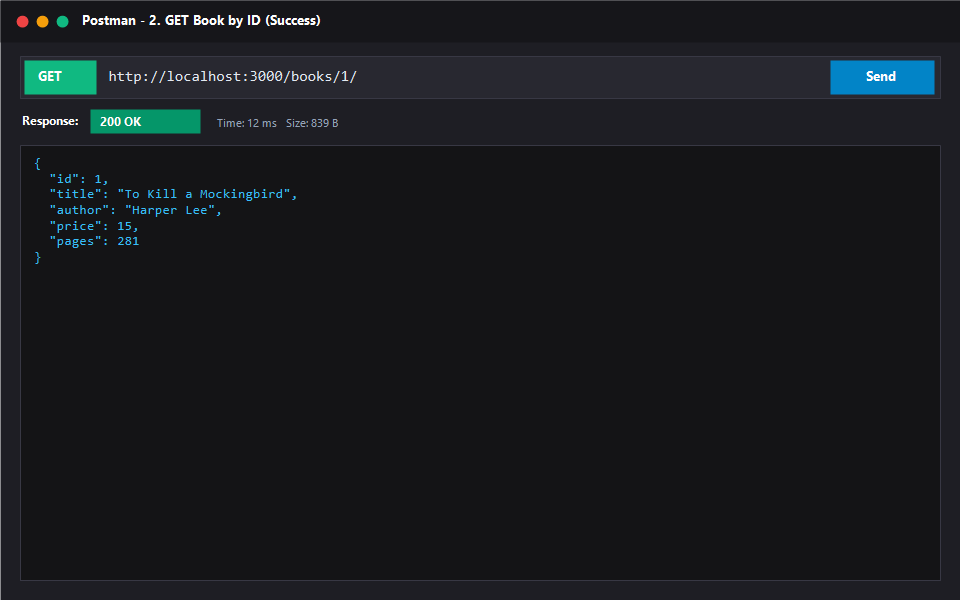
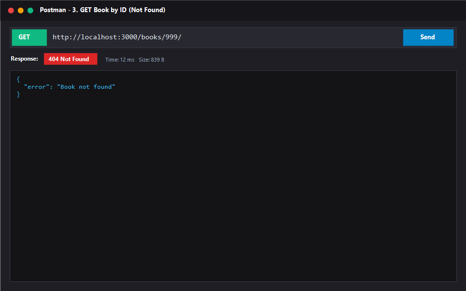
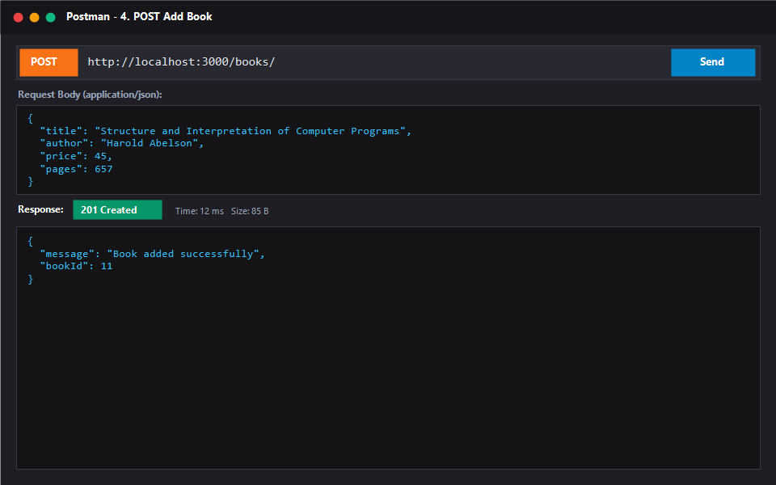
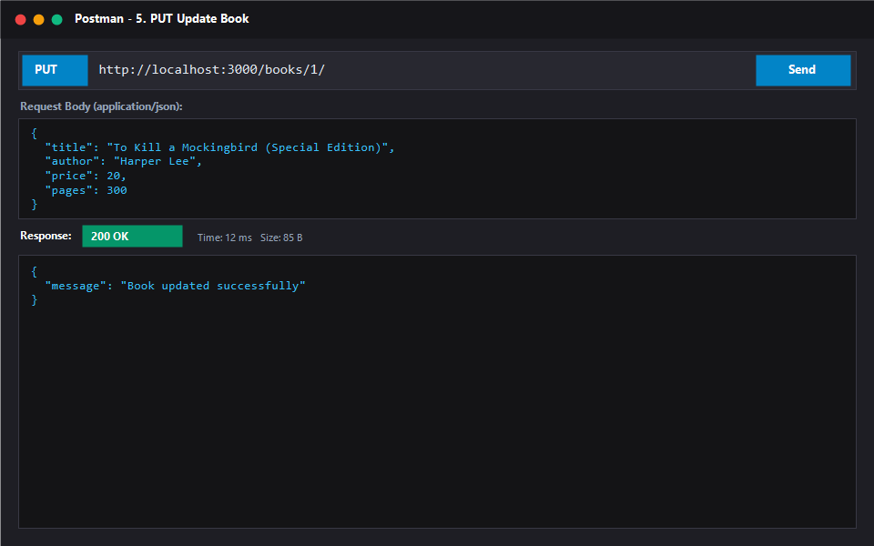
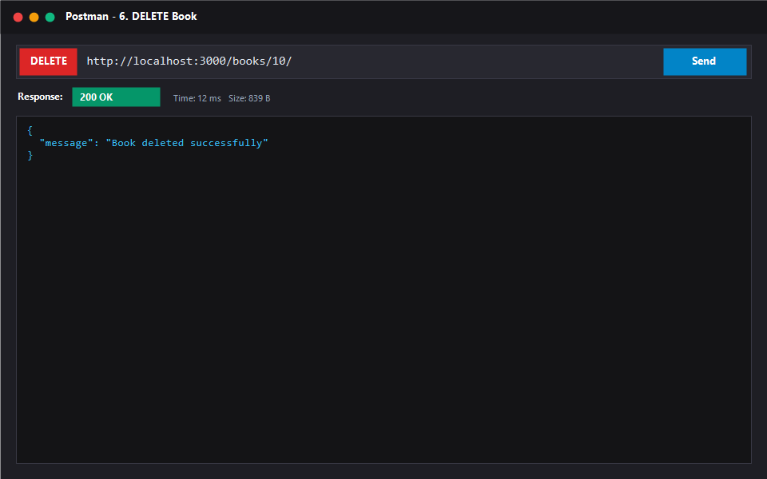
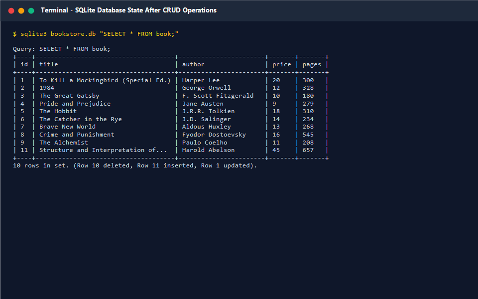

# Lab 2: SQLite database and CRUD routes

**Name:** VARUKURI ARJUN · **Registration No:** 252U1R1268 · **Section:** CSE-2E (211)  
**Live link:** [PASTE DEPLOYED URL HERE, or explain why it couldn't be deployed and rely on the Postman screenshots]

## How to run

1. **Install dependencies**:
   ```bash
   npm install
   ```

2. **Configure environment**:
   Copy `.env.example` to `.env`:
   ```bash
   cp .env.example .env
   ```
   *Environment Variables*:
   - `PORT`: Port number on which the Express server listens (default: `3000`).
   - `DB_PATH`: Relative or absolute file path to the SQLite database (default: `./bookstore.db`).

3. **Recreate or seed the database from schema.sql and seed.sql**:
   - Using sqlite3 CLI:
     ```bash
     sqlite3 bookstore.db < schema.sql
     sqlite3 bookstore.db < seed.sql
     ```
   - Alternatively, using the provided Node.js database setup script:
     ```bash
     node setup-db.js --clean
     ```

4. **Start the application**:
   - Development mode (with auto-restart via nodemon):
     ```bash
     npm run dev
     ```
   - Production / Standard start:
     ```bash
     npm start
     ```

## Endpoints

| Method | Path | Description | Success status | Error statuses |
| :--- | :--- | :--- | :--- | :--- |
| `GET` | `/books/` | Retrieves the list of all books | `200 OK` | `500 Internal Server Error` |
| `GET` | `/books/:bookId/` | Retrieves a single book by its primary ID | `200 OK` | `400 Bad Request` (invalid/non-positive ID)<br>`404 Not Found` (book not found)<br>`500 Internal Server Error` |
| `POST` | `/books/` | Creates a new book record | `201 Created` | `400 Bad Request` (missing/invalid fields)<br>`500 Internal Server Error` |
| `PUT` | `/books/:bookId/` | Updates an existing book record by ID | `200 OK` | `400 Bad Request` (invalid ID or payload)<br>`404 Not Found` (book not found)<br>`500 Internal Server Error` |
| `DELETE` | `/books/:bookId/` | Deletes a book record by ID | `200 OK` | `400 Bad Request` (invalid/non-positive ID)<br>`404 Not Found` (book not found)<br>`500 Internal Server Error` |

*(Note: Any unknown route triggers a catch-all `404 Not Found` response with `{"error": "Route not found"}`)*

## Database

The database is powered by SQLite and stored in `bookstore.db`.

### Table Schema (`book`):
```sql
CREATE TABLE IF NOT EXISTS book (
  id INTEGER PRIMARY KEY AUTOINCREMENT,
  title TEXT,
  author TEXT,
  price INTEGER,
  pages INTEGER
);
```

### Inspecting the Database:
- Using the sqlite3 CLI tool:
  ```bash
  sqlite3 bookstore.db "SELECT * FROM book;"
  ```
- Or using the included inspection script:
  ```bash
  node inspect-db.js "SELECT * FROM book;"
  ```

## Screenshots









## Viva notes

### 1. Why await the database call?
Database operations involve asynchronous I/O across the filesystem. In JavaScript, asynchronous operations return a `Promise`. By using `await`, execution within the async route handler pauses until the Promise resolves with the actual query result. This ensures the data is retrieved or modified before sending the HTTP response back to the client, preventing race conditions, empty responses, and unhandled promise rejections.

### 2. What is SQL injection and how do `?` placeholders prevent it?
**SQL Injection** occurs when untrusted user input is directly concatenated or interpolated into a SQL command string. An attacker can craft malicious inputs (e.g., `1 OR 1=1; DROP TABLE book;`) to alter the SQL syntax and manipulate or destroy the database.  
Parameterised queries with **`?` placeholders** prevent this by separating the query structure from the user data. The database engine compiles and parses the SQL command template first. The values bound to the `?` placeholders are then transmitted separately and treated strictly as literal data values, never as executable SQL code.

### 3. When is PUT used instead of POST?
- **POST** is used to create a new subordinate resource. The server determines the new resource's identity (such as generating an autoincrement ID). POST is not idempotent; issuing the same POST request multiple times creates multiple distinct records.
- **PUT** is used to update or replace an existing resource identified by a specific URI (e.g., `/books/5/`). PUT is idempotent; sending the same PUT request multiple times results in the exact same resource state on the server.

## Deployment note

On platforms such as Render's free tier, the application runs on containers with an **ephemeral filesystem**. This means that any disk modifications—such as adding, updating, or deleting rows in `bookstore.db` at runtime—are stored only temporarily and are wiped whenever the service restarts, sleeps from inactivity, or redeploys. On each fresh container boot, the database resets to the `bookstore.db` file committed in the Git repository.

### How to deploy on Render (Zero-Error Setup):
- **Option 1 (Blueprint / Automatic)**: In Render dashboard, click **New +** -> **Blueprint**, select this repository, and click **Apply**. The included `render.yaml` automatically configures the service, root directory (`lab-02`), and health checks.
- **Option 2 (Web Service / Manual)**: In Render dashboard, click **New +** -> **Web Service**:
  - **Environment**: Node
  - **Root Directory**: `lab-02` (or leave blank; the root script also forwards seamlessly to `lab-02`)
  - **Build Command**: `npm install`
  - **Start Command**: `npm start`
  - **Health Check Path**: `/books/`

## Notes

### Problems faced and how I solved them
- *Problem 1:* [Describe any problem encountered during setup or development, e.g., handling asynchronous database initialization before starting the Express server]  
  *Solution:* [Describe how it was resolved, e.g., wrapped `db.open()` and `app.listen()` inside `initializeDBAndServer()` to ensure DB readiness before accepting HTTP traffic]
- *Problem 2:* [Describe any issue with parameter validation or SQL syntax]  
  *Solution:* [Describe resolution using strict regex validation and parameterised queries]

